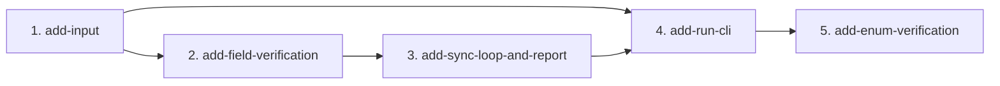

# MVP Capability Change Plan — method-sync-v2

**Phase 3 фабрики** — розбиття MVP на зміни OpenSpec, які цикл доставки проводить по одній:
spec change → тести (червоні) → реалізація (зелена) → батарея → `review-gate` → архів → коміт.

> Входи: `docs/product-brief.md`, `docs/requirements.md` (підписано на checkpoint 1, 2026-09-29),
> базові специфікації `openspec/specs/*/spec.md` (Phase 2).

## 1. Принципи нарізки

1. Слайс ≈ одна капабіліті = один-два модулі `src/method_sync/`, які можна спроєктувати, зібрати,
   перевірити й архівувати разом.
2. Порядок за залежностями: спершу те, що імпортують усі (`Method` з реєстру, вердикт перевірки).
3. Кожна MVP-вимога має рівно одного власника (таблиця розділу 5). NFR ідуть зі своїм доменом;
   наскрізні — нижче.
4. Імена — `add-<capability>`, як у фабриці; капабіліті — ті самі, що в базових специфікаціях.
5. Еталон реалізації — код method-sync v1 (`~/src/method-sync/src/method_sync/`): його
   читають, а не копіюють наосліп; тести пишуться зі специфікації v2 до коду.

## 2a. Швидкий шлях (рішення власника 2026-09-30, після слайсу 1)

Слайс 1 `add-input` пройшов повний цикл (три раунди рецензії) і заархівований. Власник обрав швидкий шлях: слайси 2–5
зведено в один `add-core` (перевірка полів, енами, цикл і звіт, CLI; 65 MVP FR) з кодом v1 як основою, одним раундом
`review-gate` на весь новий код (блокують major/critical, ADR-0003) і e2e-прогоном зі справжнім агентом. Evals і
`trajectory-eval` фабрики свідомо не робляться — у звіті це позначено як «не зроблено», не як PASS. Таблиця нижче —
схвалений на checkpoint 2 план, лишений для історії.

## 2. Зміни

Власник схвалив на checkpoint 2 (2026-09-30) п'ять слайсів замість семи з чернетки: дрібні капабіліті злито
(реєстр + живий виклик, цикл + звіт), перевірка полів, CLI і енами — окремо. Причина — вартість
`review-gate` на слайс і дедлайн; тип доказів той самий (червоне → зелене на кожну капабіліті).

| # | Change | Baseline specs | MVP FRs | NFRs | Depends on | Parallel |
|---|---|---|---|---|---|---|
| 1 | `add-input` | registry, live-capture | FR-1…FR-10, FR-23…FR-30 | NFR-4, NFR-11 | — | serialize: `Method` і фікстуру беруть усі наступні |
| 2 | `add-field-verification` | field-verification | FR-31…FR-44, FR-46 | NFR-2, NFR-5, NFR-11, NFR-13 | 1 | serialize |
| 3 | `add-sync-loop-and-report` | sync-loop, run-report | FR-60…FR-84 | NFR-1, NFR-3, NFR-12, NFR-13 | 2 | serialize |
| 4 | `add-run-cli` | run-cli | FR-14…FR-22, FR-90…FR-93 | NFR-6…NFR-10, NFR-14, NFR-15 | 1, 2, 3 | serialize: `__main__.py` склеює все |
| 5 | `add-enum-verification` | enum-verification | FR-47…FR-58 | — | 2, 3, 4 | serialize: торкається `verify.py`, `agent.py`, `report.py` |

**Наскрізні NFR, які тримає кожен слайс:** NFR-11 (повідомлення про помилку називає винуватця),
NFR-13 (тексти українською, ідентифікатори англійською), NFR-14 (лише stdlib).

## 3. Граф залежностей

**Критичний шлях:** 1 → 2 → 3 → 4 → 5, усі послідовно. Паралелізм — усередині слайсу (чотири рецензенти
`review-gate` одночасно), а не між слайсами.

## 4. Обсяг і критерії готовності

Для всіх слайсів Definition of done однакова в частині процесу: тести слайсу написані
`test-engineer` зі специфікації до коду і спостережено червоними; `capability-implementer` довів їх до
зеленого без послаблення тестів; `npm run lint && npm run test:run && npm run build` і
`openspec validate --all --strict` зелені; smoke слайсу виконано на реальних входах; `review-gate`
чистий і `review-findings.json` збережено; зміну архівовано; коміт несе `Slice:` і `Refs:`.

### 4.1 `add-input` — частина registry

- **Scope in:** читання TOML, обов'язкові й необов'язкові поля, сувора валідація з назвою поля,
  запис `[[method]]` з `path`, `model`, `client_method`, `args`, `call`.
- **Scope out:** коротка форма як повноцінний запис (FR-11), дублі (FR-12), неоднозначний метод (FR-13).
- **Smoke:** реєстр method-sync v1 (`~/src/method-sync/registry.toml`) читається без змін
  (FR-3: `status`, `credentials`), шлях `lib` замінено на `.sandbox/binancefutures`.
- **Ризики:** немає.

### 4.1 `add-input` — частина live-capture

- **Scope in:** живий GET, фікстура, slug, «жива відповідь недоступна» (помилка, таймаут, не-200,
  порожнє, не-JSON, `[]`/`{}`), об'єднання ключів — у перевірці, не тут.
- **Scope out:** параметри з документації (FR-95…FR-99).
- **Smoke:** живий `/fapi/v1/premiumIndex` → фікстура з 8 ключами; недосяжний `base_url` → код `3`,
  фікстури немає.
- **Ризики:** мінлива відповідь біржі між фікстурою і раннером (5.4 вимог) — лишається як у v1.

### 4.2 `add-field-verification`

- **Scope in:** `verify_cmd`, генерація раннера поза `lib`, класпас, `javac`, виклик клієнта з
  перехопленням винятку (FR-46), сирий JSON, інтроспекція Jackson, конверт, звіряння в обидва боки,
  вердикт JSON, `System.exit`, стадії й ліміти часу.
- **Scope out:** строга десеріалізація (FR-45), вкладені моделі (FR-102, FR-103), енами — слайс 7.
- **Smoke (інтеграційний шар):** раннер проти `.sandbox/binancefutures` і живої біржі без агента:
  `premiumIndex` зелений; `fundingRate` червоний, `missing = [markPrice, rateType]`; клієнт, що кидає
  виняток, дає червоний вердикт із `client_error` швидше за таймаут. Це перші тести
  `npm run test:integration`.
- **Ризики:** ADR-кандидат немає; головний ризик — висіння JVM (R-005, R-014), закривається FR-42/FR-46.

### 4.3 `add-sync-loop-and-report` — частина sync-loop

- **Scope in:** тест другої половини FR-30 — бриф забороняє брати склад із документації (рецензія `add-input`, R1-13); цикл перевірка → агент → перевірка, ліміт ітерацій, лог ітерацій, виклик
  `claude -p` (acceptEdits, `--add-dir runs/`, `--allowedTools Bash(<verify_cmd>)`, порожній stdin,
  cwd = `lib`), бриф і вузький обсяг правки.
- **Scope out:** рецензент у циклі (FR-100, FR-101).
- **Smoke:** цикл із справжнім агентом на `fundingRate` у `.sandbox/` — `markPrice`, `rateType`
  додані, перевірка зелена (FR-69).
- **Ризики:** вартість і тривалість виклику агента; обмежено `--max-iterations` і 900 с (NFR-3).

### 4.3 `add-sync-loop-and-report` — частина run-report

- **Scope in:** `runs/<slug>/report.md` з усіма полями FR-78, розходження першої перевірки, стадія
  словами, `removed`, `verify_result`, `reviewer`, завершальний рядок.
- **Scope out:** розширення звіту FR-85…FR-89.
- **Smoke:** звіт для зеленого, червоного, «не зійшовся» і `--dry-run` вердиктів.
- **Ризики:** немає.

### 4.4 `add-run-cli`

- **Scope in:** докази FR-27 на процесі CLI (агент не кличеться, `lib` не змінюється, коли жива відповідь недоступна — рецензія `add-input`, R1-12); прогін по списку, `--only`, `--dry-run`, `--max-iterations`, рядки stdout і підсумок,
  коди виходу й шкала серйозності, модуль за префіксом, стандарт стилю, відсутній клас моделі, межі
  (git-операцій немає, корені запису, секрети, лише дозволені команди проти бібліотеки).
- **Scope out:** реалізація з нуля (FR-94), інші біржі (FR-108).
- **Smoke:** `--dry-run` по реєстру з трьох методів на `.sandbox/`; `git -C .sandbox/binancefutures
  status --porcelain` і `diff --cached` до й після однакові (NFR-8, NFR-10).
- **Ризики:** немає.

### 4.5 `add-enum-verification`

- **Scope in:** енамні поля верхнього рівня (значення, колекція, ключі мапи), живі значення по всіх
  об'єктах, оголошені значення за Jackson без запасника, розходження енаму червонить вердикт,
  `enum_unseen` не червонить і не видаляється (принцип IX), бриф «лише дописати константу перед
  запасником», поля звіту `enum_mismatch`/`enum_unseen`.
- **Scope out:** вкладені енами (FR-59), енами з чужих артефактів (FR-104).
- **Smoke:** живий `/fapi/v1/tradingSchedule` на `.sandbox/` → `FX` дописано в `MarketType`,
  перевірка зелена (FR-58); вигадана константа лишається й названа в `enum_unseen`.
- **Ризики:** енами з `@JsonProperty`/`@JsonValue` (R-013) — перевіряються десеріалізацією, не `name()`.

## 5. Покриття FR

| Слайс | MVP FRs | К-сть |
|---|---|---|
| 1 `add-input` | FR-1, FR-2, FR-3, FR-4, FR-5, FR-6, FR-7, FR-8, FR-9, FR-10, FR-23, FR-24, FR-25, FR-26, FR-27, FR-28, FR-29, FR-30 | 18 |
| 2 `add-field-verification` | FR-31, FR-32, FR-33, FR-34, FR-35, FR-36, FR-37, FR-38, FR-39, FR-40, FR-41, FR-42, FR-43, FR-44, FR-46 | 15 |
| 3 `add-sync-loop-and-report` | FR-60, FR-61, FR-62, FR-63, FR-64, FR-65, FR-66, FR-67, FR-68, FR-69, FR-70, FR-71, FR-72, FR-73, FR-74, FR-75, FR-76, FR-77, FR-78, FR-79, FR-80, FR-81, FR-82, FR-83, FR-84 | 25 |
| 4 `add-run-cli` | FR-14, FR-15, FR-16, FR-17, FR-18, FR-19, FR-20, FR-21, FR-22, FR-90, FR-91, FR-92, FR-93 | 13 |
| 5 `add-enum-verification` | FR-47, FR-48, FR-49, FR-50, FR-51, FR-52, FR-53, FR-54, FR-55, FR-56, FR-57, FR-58 | 12 |

Разом: **83 MVP FR у 5 слайсах** (82 з чернетки + FR-46, перенесений у MVP на checkpoint 1); без пропусків і
дублів.

## 6. Послідовність і що поза слайсами

1. **До Phase 4 (гейт G3):** механізм для тега `e2e` — `npm run test:e2e`, доказовий прогін CLI по
   сценаріях розділу 5.6 вимог проти свіжої копії бібліотеки в `.sandbox/`, пише
   `docs/qa/e2e-report.md`. Пише його `test-engineer` зі специфікацій до коду інструмента, тож до
   слайсу 6 він червоний — чесно, не заглушкою.
2. **Покращення фабрики PD-1…PD-7** (ретро `process-auditor`) схвалено на checkpoint 2 і застосовано
   окремими комітами `Refs: PD-x` до першого слайсу; застосовані пропозиції лежать у `docs/qa/improvements/`.
3. **Слайси 1–5** у порядку розділу 3; після кожного архіву — `openspec validate --all --strict`.
4. **Phase 5:** повний доказовий набір `npm run test:e2e`, рецензія `method-sync-reviewer` окремою
   сесією по кожному прогону, що змінив бібліотеку (BC-4).
5. **Phase 6–7:** QA-пакет, evals (NFR-11, NFR-12), глобальний `review-gate`, `trajectory-eval`, реліз
   (без деплою: CLI — push на GitHub зі схвалення власника).

Future-рядки в план не входять.
